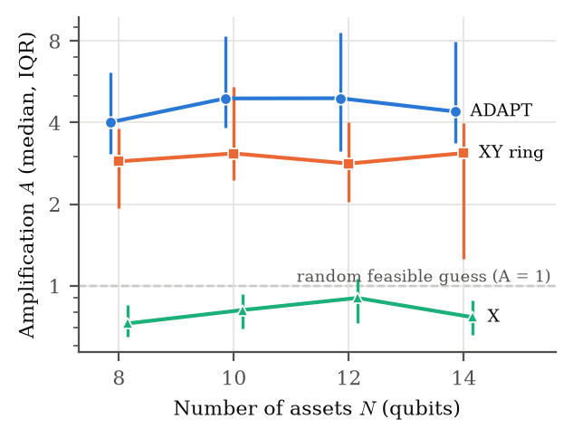
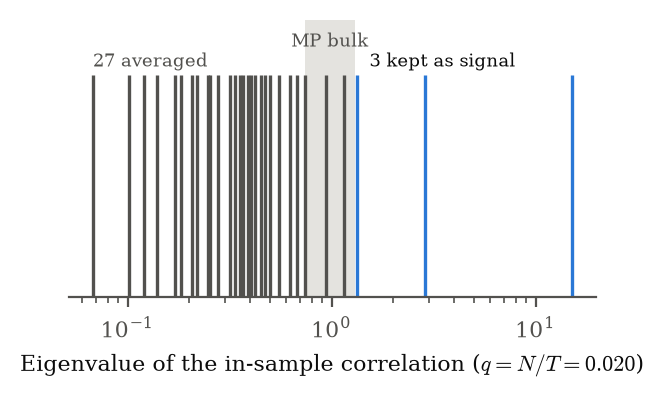
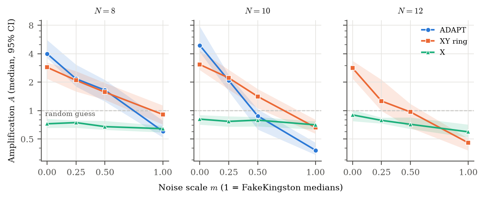
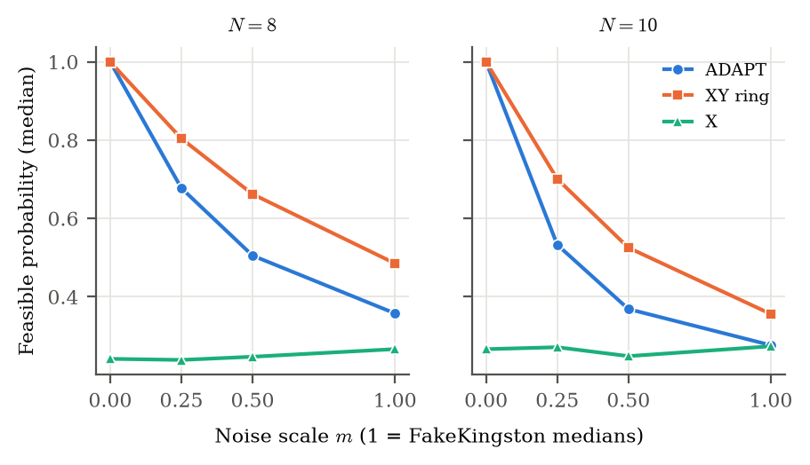

# NISQ-Folio at a glance

A one-page tour of the project: what it does, what the experiment of record found, and the code
behind the key steps. Every figure and number here is generated by the repository's scripts from
recorded runs; the full reports are linked at each step.

**Authors:** Yuvaraj Guliani and Kallol Das (equal contribution), S P Jain School of Global
Management.

## The pipeline

```
Daily prices (30 US stocks, checksummed snapshot)
  -> returns, mean mu and covariance Sigma
  -> RMT denoising (Marchenko-Pastur eigenvalue clipping), or none
  -> QUBO with an exact cardinality penalty (choose exactly K of N assets)
  -> QAOA with three mixers: X (standard), XY ring (constraint-preserving), ADAPT (adaptive)
  -> noiseless and noisy simulation (noise scale m, where m = 1 is IBM Heron-class medians)
  -> scored against random guessing and classical baselines (greedy, Markowitz, simulated annealing)
```

The experiment of record (`configs/main.yaml`, run `main_r2`) has **2,400 tasks**: N = 8, 10, 12
and 14 assets, 30 out-of-sample instances each, two denoising levels, three mixers and four
noise levels. It finished on 19 November 2026. Every analysis was pre-registered in
[DECISIONS.md](DECISIONS.md) (31 decision records) before its results were viewed.

## Results

### 1. Without noise, the constraint-preserving mixers beat random guessing

The metric is the **amplification A**: how much more probability QAOA puts on the optimal
portfolio than random guessing among valid portfolios would. A > 1 beats random guessing.



Median A [interquartile range] (share of instances with A > 1), sample covariance:

| Mixer | N = 8 | N = 10 | N = 12 | N = 14 |
|---|---|---|---|---|
| ADAPT | 4.01 [3.07, 6.13] (93%) | 4.91 [3.84, 8.33] (100%) | 4.92 [3.13, 8.58] (100%) | 4.39 [3.36, 7.95] (100%) |
| XY ring | 2.87 [1.94, 3.80] (93%) | 3.08 [2.45, 5.39] (90%) | 2.82 [2.03, 4.02] (90%) | 3.08 [1.26, 3.99] (77%) |
| X | 0.73 [0.65, 0.85] (20%) | 0.81 [0.70, 0.93] (17%) | 0.90 [0.73, 1.06] (37%) | 0.77 [0.66, 0.88] (13%) |

Full report: [docs/results/noiseless_main.md](docs/results/noiseless_main.md).

### 2. Classical heuristics are far cheaper at these sizes

Share of instances where each classical method finds the optimum:

| Method | N = 8 | N = 10 | N = 12 | N = 14 |
|---|---|---|---|---|
| Greedy | 87% | 93% | 90% | 87% |
| Markowitz + rounding | 83% | 77% | 57% | 33% |
| Simulated annealing, 200 steps | 100% | 100% | 100% | 90% |
| Simulated annealing, 500 steps | 100% | 100% | 100% | 100% |

Cost to get there (QAOA in measurement shots, SA in objective evaluations):

| Method | N = 8 | N = 10 | N = 12 | N = 14 |
|---|---|---|---|---|
| ADAPT (shots) | 339,968 | 479,232 | 651,264 | 856,064 |
| XY ring (shots) | 102,400 | 102,400 | 102,400 | 102,400 |
| SA (steps for at least 90% optimal) | 50 | 50 | 200 | 200 |

### 3. RMT denoising does not help on this universe



Only 3 of the 30 correlation eigenvalues lie above the Marchenko-Pastur noise edge and are kept
as signal; the other 27 are treated as noise and replaced by their average. Paired RMT/sample
ratios of A for QAOA (share of instances improved):

| Comparison | N = 8 | N = 10 | N = 12 | N = 14 |
|---|---|---|---|---|
| ADAPT | 1.09 (60%) | 1.04 (53%) | 0.79 (40%) | 1.12 (53%) |
| XY ring | 1.02 (53%) | 1.01 (53%) | 0.95 (47%) | 1.11 (60%) |
| X | 0.89 (17%) | 0.98 (43%) | 0.87 (30%) | 0.93 (47%) |

### 4. Under hardware-level noise, no mixer beats random guessing



Noise tolerance m\* is the noise scale at which the median A falls to 1. Below 1 means the
advantage is gone before today's error rates are reached.

| Mixer | m\* at N = 8 | m\* at N = 10 | m\* at N = 12 | Median A at m = 1, N = 12 |
|---|---|---|---|---|
| ADAPT | 0.71 [0.62, 0.82] | 0.45 [0.38, 0.51] | not run under noise | — |
| XY ring | 0.89 [0.69, > 1] | 0.69 [0.53, 0.81] | 0.46 [0.25, 0.57] | 0.46 |
| X | 0 | 0 | 0 | 0.60 |

- The deeper ADAPT circuit loses its noiseless lead first, contrary to the pre-registered
  prediction.
- The tolerable noise falls as the problem grows.
- At N = 12 and today's noise, XY does worse than the plain X mixer (paired ratio 0.64).

### 5. Noise breaks the constraint the mixers are built to preserve



Without noise, XY and ADAPT only ever output valid portfolios (exactly K assets). At today's
noise level, that share falls to 28% for XY at N = 12, the same as the X mixer, which never
enforces the constraint.

Full report: [docs/results/noisy_final.md](docs/results/noisy_final.md).

## Key code

Trimmed excerpts; docstrings, argument checks and comments are shortened. Follow the links for
the full source.

### Eigenvalue clipping ([src/nisq_folio/denoise/rmt.py](src/nisq_folio/denoise/rmt.py))

```python
def marchenko_pastur_edges(q: float, sigma2: float = 1.0) -> tuple[float, float]:
    """Return (lambda_-, lambda_+) = sigma^2 * (1 -/+ sqrt(q))^2."""
    root = np.sqrt(q)
    return sigma2 * (1.0 - root) ** 2, sigma2 * (1.0 + root) ** 2


# inside clip_correlation(): replace every eigenvalue inside the noise band by their mean
lambda_minus, lambda_plus = marchenko_pastur_edges(n / n_observations)
values, vectors = np.linalg.eigh(c)
keep = values > lambda_plus
cleaned_values = values.copy()
cleaned_values[~keep] = values[~keep].mean()
rebuilt = (vectors * cleaned_values) @ vectors.T
scale = 1.0 / np.sqrt(np.diag(rebuilt))
clean = rebuilt * np.outer(scale, scale)  # back to a unit diagonal
```

### A provably exact penalty ([src/nisq_folio/qubo/penalty.py](src/nisq_folio/qubo/penalty.py))

If P > max over m != K of (f_ub − L_m) / (m − K)², every portfolio with the wrong number of assets
scores worse than a feasible one, so the QUBO's minimum is the constrained optimum. This needs
no knowledge of the optimum itself.

```python
def sufficient_penalty(problem: PortfolioProblem, margin: float = 0.01) -> float:
    """Return P = (1 + margin) * max_{m != K} (f_greedy - L_m) / (m - K)^2."""
    f_ub = greedy(problem).objective
    bounds = cardinality_lower_bounds(problem)  # L_m = a*lambda_min*m - b*(top-m sum of mu)
    m = np.arange(problem.n + 1)
    infeasible = m != problem.k
    required = (f_ub - bounds[infeasible]) / (m[infeasible] - problem.k) ** 2
    return float((1.0 + margin) * max(required.max(), np.finfo(float).tiny))
```

### The XY ring mixer and Dicke state ([src/nisq_folio/mixers/xy.py](src/nisq_folio/mixers/xy.py))

```python
def apply_xy_pair(state, i, j, beta, n):
    """Apply exp(-i beta (X_i X_j + Y_i Y_j) / 2): swaps amplitude between |01> and |10>."""
    first, second = _pair_indices(n, i, j)
    c, s = np.cos(beta), -1j * np.sin(beta)
    out = np.array(state, dtype=np.complex128)
    a, b = out[first].copy(), out[second].copy()
    out[first] = c * a + s * b
    out[second] = s * a + c * b
    return out


def dicke_state(n: int, k: int):
    """Return |D^N_K>: equal amplitude C(N, K)^(-1/2) on every bitstring with K ones."""
    weights = np.array([bin(x).count("1") for x in range(2**n)])
    state = np.zeros(2**n, dtype=np.complex128)
    state[weights == k] = comb(n, k) ** -0.5
    return state
```

### Scoring against random guessing ([src/nisq_folio/qaoa/metrics.py](src/nisq_folio/qaoa/metrics.py))

```python
n_optimal = int(landscape.optimal.sum())
p_opt = float(p[landscape.optimal].sum())
uniform_feasible = n_optimal / int(landscape.feasible.sum())   # random guess among valid portfolios
return DistributionMetrics(
    p_optimal=p_opt,
    p_feasible=float(p[landscape.feasible].sum()),
    expected_gap=float(p @ landscape.gaps()),
    amplification_feasible=p_opt / uniform_feasible,         # A > 1 beats random guessing
    ...
)
```

### The noise crossover m\* ([src/nisq_folio/analysis/noise.py](src/nisq_folio/analysis/noise.py))

```python
def crossover(levels, medians) -> float:
    """Noise level m* where the median amplification first falls to 1."""
    m = np.asarray(levels, dtype=float)
    a = np.log(np.maximum(np.asarray(medians, dtype=float), 1e-300))
    if a[0] <= 0:
        return 0.0  # no advantage even without noise
    below = np.flatnonzero(a <= 0)
    if below.size == 0:
        return float("inf")  # never crossed: reported as "> 1"
    j = int(below[0])
    t = a[j - 1] / (a[j - 1] - a[j])  # interpolate ln A ...
    if m[j - 1] == 0:
        return float(t * m[j])  # ... linearly in m from m = 0
    return float(np.exp(np.log(m[j - 1]) + t * (np.log(m[j]) - np.log(m[j - 1]))))  # ... in ln m
```

## What one run record looks like

Each of the 2,400 tasks writes a JSON record with its result, its timing and its provenance (git
commit and config fingerprint). Here is one noisy task at N = 12 (abridged):

```json
{
  "task_id": "qaoa__N12__i000__none__xy_ring__m1",
  "tickers": ["NVDA", "CSCO", "PFE", "ABT", "JPM", "WFC", "CVX", "SLB", "EOG", "PG", "WMT", "HON"],
  "run": {
    "noise_level": 1.0,
    "gammas": [1.8567], "betas": [2.7026],
    "total_shots": 102400,
    "two_qubit_gates": 1041,
    "metrics": {
      "p_optimal": 0.000536,
      "p_feasible": 0.2805,
      "amplification_feasible": 0.4952,
      "samples_to_90": 4296.0
    }
  },
  "wall_seconds": 2515.2,
  "git": {"commit": "e1dfeb596649a91611eb160a883ef61b83d4c610", "dirty": false},
  "config_sha256": "32a8bbf9fb471d4978f8897e42ad6e5679ae6036caf8c368a3df1204d3f1dc83",
  "finished_at": "2026-11-11T18:47:03+00:00"
}
```

## Quality checks

From the final check on 20 November 2026:

```text
$ uv run ruff check .
All checks passed!
$ uv run ruff format --check .
125 files already formatted
$ uv run pytest
402 passed in 313.11s (0:05:13)
Required test coverage of 85.0% reached. Total coverage: 97.73%
```

Seeds are passed explicitly everywhere (no global random state), so any single task re-runs to
the same result. The whole project runs on a laptop at zero cost.

## Where to go next

| To see | Open |
|---|---|
| The paper | [paper/main.tex](paper/main.tex) (build with Tectonic) |
| Every design decision and pre-registration | [DECISIONS.md](DECISIONS.md) |
| How to install and reproduce | [README.md](README.md) |
| Scope and milestones | [PROJECT_PLAN.md](PROJECT_PLAN.md) |
